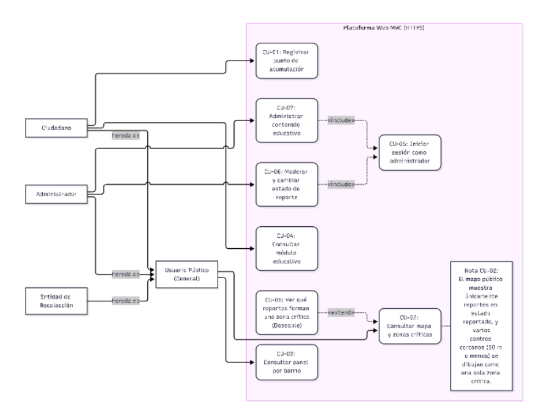
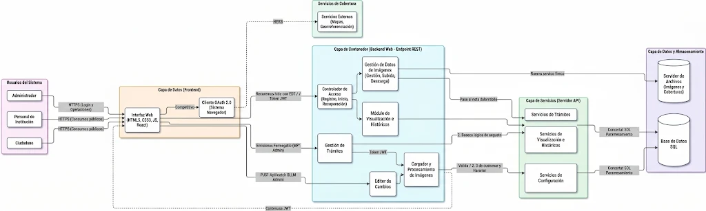
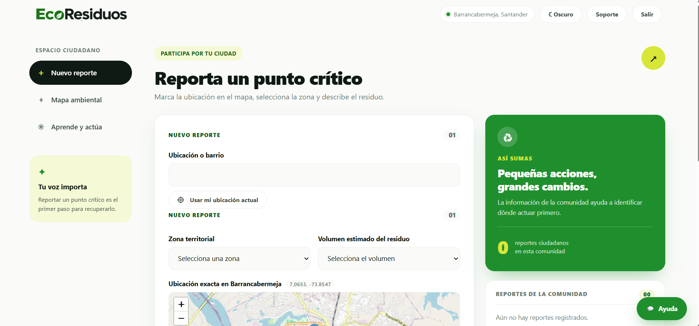
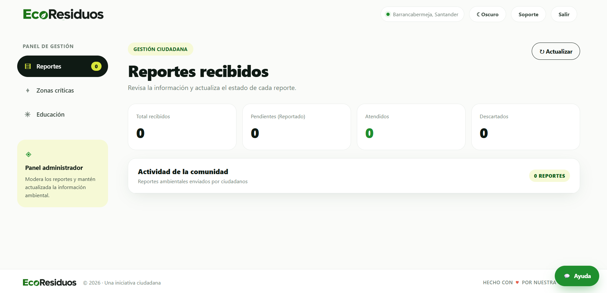

#  EcoResiduos — Plataforma Web de Gestión y Educación Ambiental

Plataforma web desarrollada con arquitectura **Modelo-Vista-Controlador (MVC)** en **PHP nativo** para el reporte ciudadano georreferenciado, el monitoreo administrativo y la educación ambiental sobre la acumulación de residuos sólidos en **Barrancabermeja, Santander**.

---

##  Funcionalidades

- **Reporte ciudadano georreferenciado:** registro de puntos críticos de acumulación de residuos con captura de ubicación GPS, selección en un mapa interactivo (**Leaflet.js** sobre **OpenStreetMap**), carga de evidencia fotográfica y clasificación por zonas.
- **Panel administrativo:** gestión, filtrado y actualización del estado de los reportes recibidos. Está protegido con autenticación mediante sesiones PHP y contraseñas cifradas con `bcrypt`.
- **Educación ambiental:** módulo informativo sobre clasificación de residuos, reciclaje y buenas prácticas ambientales.
- **Interfaz adaptativa:** diseño responsivo con soporte para tema claro y modo oscuro.

---

##  Diagramas

### Casos de uso


### Arquitectura MVC


---

##  Arquitectura del proyecto

El sistema utiliza un **Front Controller** (`index.php`): todas las peticiones entran por un único punto de acceso, el enrutador de `Core/` las dirige a un controlador, y el controlador consulta los modelos y entrega los datos a una vista.

```text
Solicitud HTTP → index.php → Core (enrutador) → Controller → Model (PDO) → MySQL
                                                    ↓
                                                  View
```

Estructura de carpetas:

```text
EcoResiduos/
├── BD/             # Script SQL con la estructura y datos iniciales de la base de datos
├── Config/         # Constantes de conexión a MySQL y URL base del sistema
├── Controller/     # Controladores MVC (enrutamiento, reportes, panel admin y autenticación)
├── Core/           # Núcleo del enrutador frontal y conexión PDO a la base de datos
├── docs/           # Diagramas y recursos para la documentación
├── Entities/       # Clases de entidad del dominio (Reporte, Zona, Administrador, etc.)
├── Model/          # Modelos de acceso a datos con consultas preparadas PDO
├── Public/         # Recursos estáticos (CSS, JavaScript, imágenes y cargas de reportes)
├── View/           # Vistas y plantillas HTML/PHP de la interfaz de usuario
├── .htaccess       # Reglas de reescritura de URL amigables para Apache
└── index.php       # Punto de entrada único (Front Controller)
```

---

## 🛠️ Tecnologías

| Capa | Tecnologías |
|------|-------------|
| Backend | PHP nativo con PDO |
| Base de datos | MySQL / MariaDB |
| Frontend | HTML5, CSS3, JavaScript |
| Mapas | Leaflet.js, OpenStreetMap |
| Seguridad | Sesiones PHP, `password_hash` (bcrypt) |
| Servidor | Apache con `mod_rewrite` |

---

##  Requisitos

- PHP 7.4 o superior
- MySQL o MariaDB
- Apache con `mod_rewrite` habilitado (incluido en WAMP, XAMPP o similares)
- Navegador moderno y conexión a internet para cargar el mapa

---

##  Instalación

1. Clona el repositorio o descarga el ZIP:
   ```bash
   git clone https://github.com/<tu-usuario>/EcoResiduos.git
   ```
2. Copia la carpeta al directorio público de tu servidor local, por ejemplo `C:\wamp64\www\EcoResiduos`.
3. Crea una base de datos en phpMyAdmin e importa el script ubicado en `BD/`.
4. Ajusta las constantes de `Config/`: host, nombre de la base de datos, usuario, contraseña y URL base del sistema.
5. Abre `http://localhost/EcoResiduos` en tu navegador.

---

##  Acceso al panel administrativo

Para crear el primer administrador, genera un hash de contraseña con `bcrypt` e insértalo en la tabla de administradores de la base de datos. Nunca guardes contraseñas en texto plano.

```bash
php -r "echo password_hash('tu_contraseña', PASSWORD_BCRYPT);"
```

<!--
##  Capturas de pantalla


-->


---

##  Autor

Desarrollado por **Andrés Felipe Durán Pérez**. 